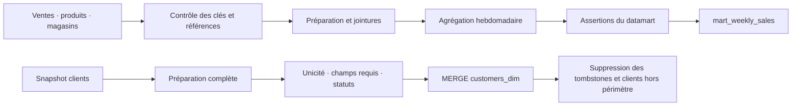

# Dataform · transformations et qualité dans BigQuery

Projet de portfolio de Mehdi Zobiri, issu d'un atelier de bootcamp puis revu pour rendre les transformations, les contrôles et les scénarios de reprise inspectables.

Deux parcours sont réunis : un datamart de ventes hebdomadaires et une dimension clients représentant l'état courant. Les modèles sont écrits en SQLX ; JavaScript fournit les clés et les paramètres communs.

**Statut de cette édition :** compilation et tests locaux vérifiés. Le scénario d'intégration BigQuery est fourni mais **n'a pas été exécuté sur cette version**. Les preuves historiques concernent l'exercice d'origine, pas les corrections de ce dépôt. Voir [validation](docs/VALIDATION.md) et [provenance](docs/PROVENANCE.md).



## Ce que le projet démontre

- Préparer des lignes de vente imbriquées, nettoyer les libellés et joindre les référentiels.
- Agréger les quantités et montants par semaine, magasin et produit.
- Faire dépendre les sorties de contrôles qualité explicites. Une assertion échouée empêche leur mise à jour lors d'une exécution du graphe avec ses dépendances ; une ancienne sortie reste disponible.
- Insérer et mettre à jour les clients par identifiant stable, puis appliquer les suppressions signalées par `to_delete`.
- Distinguer une anomalie dans la source d'un doublon introduit uniquement dans la cible : une reconstruction ne remplace pas la correction d'une source invalide.

## Vérifier localement

Prérequis : Node.js 22 ou plus récent, npm ; Python 3.10 ou plus récent pour le lanceur de tests cloud.

```bash
npm ci
npm test
python3 -m unittest discover -s tests -p 'test_*.py'
npm run compile
```

Ces commandes ne se connectent pas à BigQuery. `npm test` compile le graphe et vérifie ses contrats, pas l'exécution du SQL dans le moteur BigQuery.

Les versions sont verrouillées : Core **3.0.0**, conservé de l'exercice ; CLI **3.1.2**, mis à jour pour l'édition portfolio. L'audit des dépendances est décrit dans [VALIDATION.md](docs/VALIDATION.md).

## Paramétrage

| Paramètre | Valeur par défaut | Usage |
|---|---|---|
| `defaultDatabase` | `example-gcp-project` | Projet d'exemple à remplacer avant toute exécution cloud |
| `defaultLocation` | `EU` | Localisation des datasets et des jobs |
| `datasetPrefix` | `df_demo` | Préfixe des datasets sources et sorties |
| `filterCountry` | vide | Tous les pays ; `France` sélectionne les clients français |

```bash
npm run compile -- --default-database=mon-projet-gcp \
  --vars=datasetPrefix=df_demo,filterCountry=France
```

Avec le préfixe `df_demo`, les datasets sont `df_demo_raw`, `df_demo_stage`, `df_demo_mart` et `df_demo_dwh`. Les assertions explicites sont dans le dataset de préparation. Le préfixe s'applique aussi aux déclarations des sources.

## Scénario reproductible dans BigQuery

Les données de démonstration sont **nouvelles et synthétiques** : aucun fichier client d'origine n'est publié. Le script crée un ensemble de datasets `df_it_…` inédit et teste l'ajout, la modification, la suppression, les changements de pays, les doublons et la reprise.

```bash
# Afficher le plan : aucune connexion ni modification cloud.
python3 scripts/integration_bigquery.py --project=mon-projet-gcp
```

L'exécution cloud exige explicitement `--execute`, des identifiants Google Cloud et un projet permettant les requêtes BigQuery. Elle crée des ressources et consomme du stockage et des requêtes. Les instructions et le nettoyage sont dans [TESTS.md](docs/TESTS.md).

## Choix et limites

Le traitement clients utilise un **MERGE incrémental alimenté par une relecture complète de la source**. Il n'effectue pas d'extraction incrémentale par timestamp. Ce choix, adapté au petit exercice, évite de perdre une modification dont la date est ancienne ou inchangée. Il coûte davantage qu'une lecture ciblée sur un grand volume.

La source doit fournir au plus une ligne courante par `customer_id`. Une suppression doit être signalée par `to_delete` : l'absence physique d'une ligne n'est pas interprétée comme une suppression en mode incrémental. Il ne s'agit ni d'une solution CDC ni d'une dimension historisée SCD2.

Le `MERGE` et le `DELETE` sont deux instructions successives, sans transaction commune ajoutée par le projet. Une interruption peut laisser temporairement des tombstones ; une reprise complète du parcours est nécessaire. Exécuter un seul parcours clients à la fois, avec une source stable pendant la préparation.

Le datamart conserve la convention de l'atelier : `YEAR` et `WEEK` GoogleSQL, pas la semaine ISO. Les libellés magasin/produit font partie du grain ; le modèle n'est pas conçu comme un référentiel historique de changements de noms. Le nombre de tickets distincts par produit n'est pas additionnable entre produits. Les montants sont calculés à partir des lignes, sans rapprochement automatique au total du ticket.

## Lire la suite

- [Étude de cas](docs/ETUDE-DE-CAS.md)
- [Corrections et changements de comportement](docs/CHANGEMENTS.md)
- [Tests et exécution dans BigQuery](docs/TESTS.md)
- [Validation effectivement réalisée](docs/VALIDATION.md)
- [Origine des modèles et éléments historiques](docs/PROVENANCE.md)

Références : [CLI Dataform](https://docs.cloud.google.com/dataform/docs/use-dataform-cli), [assertions](https://docs.cloud.google.com/dataform/docs/test-data), [dépendances](https://docs.cloud.google.com/dataform/docs/dependencies).
